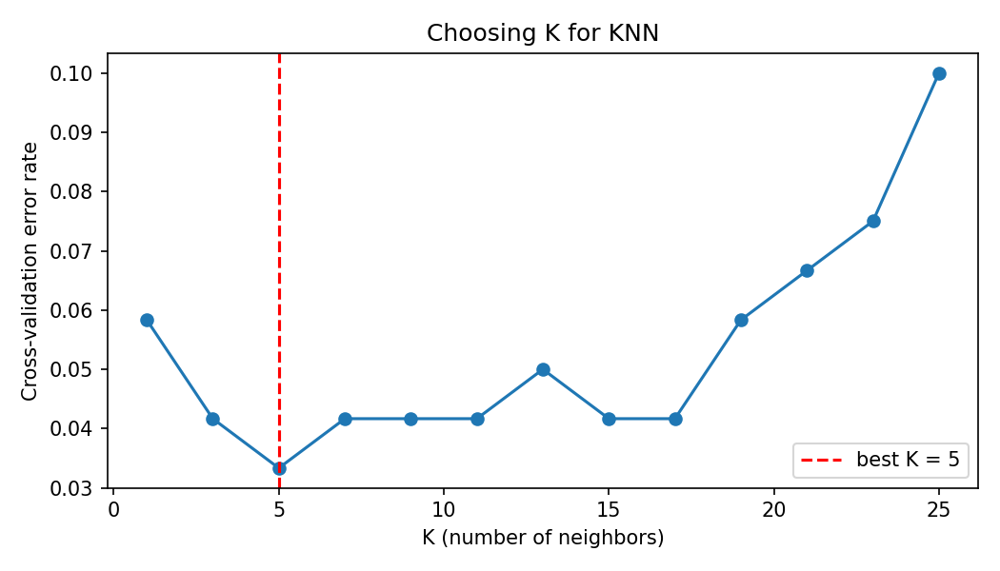
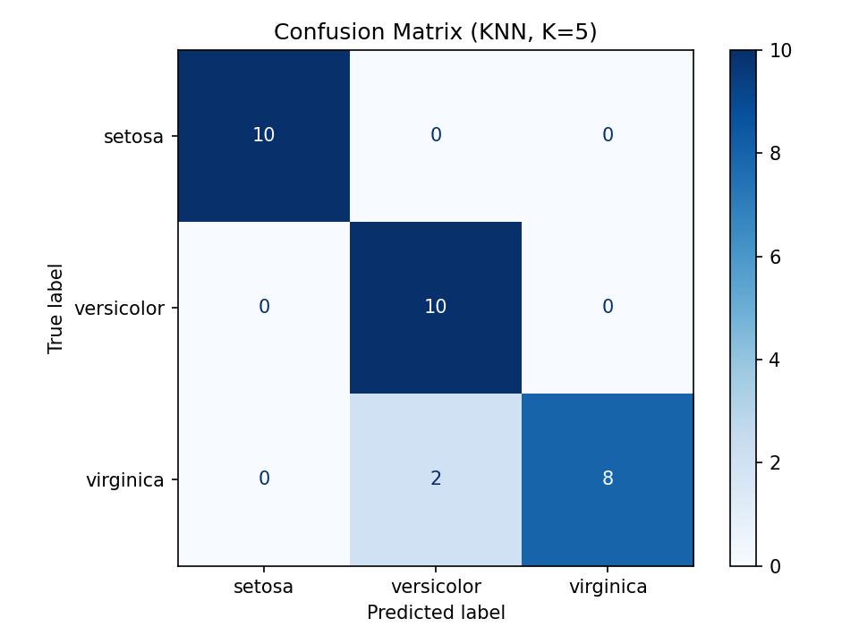

# Iris Flower Classification with KNN

A supervised learning project that classifies iris flowers into three species using the **K-Nearest Neighbors** algorithm. Built as **Project 2** of the DecodeLabs Artificial Intelligence Industrial Training Kit (Batch 2026).

## What it does

- Loads and explores the Iris dataset (150 samples, 4 features, 3 balanced classes)
- Scales features with `StandardScaler` (fitted on training data only, to avoid data leakage)
- Shuffles and splits the data 80% training / 20% testing (stratified, so every class is represented)
- Picks the best `K` automatically using 5-fold cross-validation
- Trains a KNN classifier and evaluates it with a confusion matrix, precision, recall and F1 score
- Predicts the species of a brand-new flower

## Pipeline (IPO)

| Stage | Steps |
|---|---|
| Input | Load Iris data, explore it, feature scaling |
| Process | Shuffle and split, choose K, train KNN |
| Output | Accuracy, confusion matrix, F1 score |

## Results

| Metric | Value |
|---|---|
| Best K (cross-validation) | 5 |
| Test accuracy | 93.33% |
| Macro F1 score | 0.933 |

Confusion matrix (rows = actual, columns = predicted):

```
             setosa  versicolor  virginica
setosa          10        0          0
versicolor       0       10          0
virginica        0        2          8
```

Setosa is classified perfectly. The only mistakes are two virginica flowers predicted as versicolor, which is expected because those two species overlap in feature space.

| Choosing K | Confusion matrix |
|---|---|
|  |  |

Exact numbers can differ slightly with another random seed or a different scikit-learn version.

## Getting started

Requires **Python 3.9+**.

```bash
git clone https://github.com/imran5775/Data-Classification-KNN.git
cd Data-Classification-KNN
pip install -r requirements.txt
python iris_classifier.py
```

Options:

```bash
python iris_classifier.py --k 7        # use a fixed K instead of searching
python iris_classifier.py --no-show    # save plots without opening windows
```

## Project structure

```
Data-Classification-KNN/
├── iris_classifier.py     # full pipeline
├── requirements.txt
├── images/                # generated plots
├── README.md
└── .gitignore
```

## Key concepts

- **Supervised learning**: the model learns patterns from labelled examples instead of hand-written rules.
- **Feature scaling**: KNN relies on distance, so features on larger scales would dominate without it.
- **Train/test split**: the test set is never used for training, so the score reflects unseen data.
- **Choosing K**: very small K overfits to noise, very large K becomes too generic.
- **F1 score**: balances precision and recall, which is more reliable than accuracy alone.

## Future improvements

- Compare KNN with Decision Tree, SVM and Logistic Regression
- Try a larger or imbalanced dataset
- Add a simple command-line prompt to classify user-entered measurements

## Author

**Muhammad Imran**
DecodeLabs AI Internship, Batch 2026
